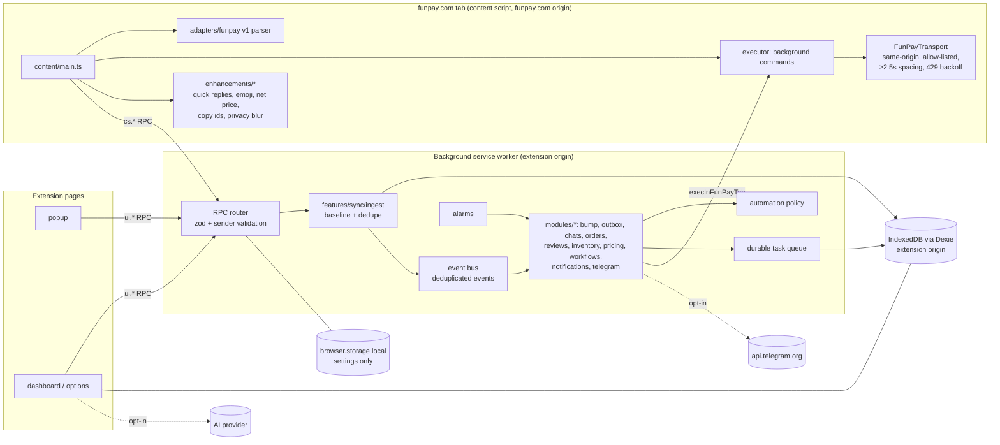

# Architecture

FunPro is a Manifest V3 extension built with WXT, React and strict TypeScript. It is local-first. FunPay has no public API, so every FunPay-specific detail is isolated in a versioned adapter. Every automated action passes through one policy gate, one durable queue and one rate-limited transport.

## Runtime contexts

| Context                        | Origin                      | Responsibilities                                                                                                                                                                            | Data access                                                                                                                                                                                |
| ------------------------------ | --------------------------- | ------------------------------------------------------------------------------------------------------------------------------------------------------------------------------------------- | ------------------------------------------------------------------------------------------------------------------------------------------------------------------------------------------ |
| Content script (`src/content`) | funpay.com (isolated world) | Reads the CSRF token from the page and keeps it there. Parses pages the seller opens (passive ingestion). Runs commands from the background with same-origin `fetch`. Adds on-page helpers. | No extension IndexedDB and (Chrome) no `storage.local`. Gets data through `cs.*` RPC and the page mirror, never secrets. Offer forms reach the background without the CSRF token or goods. |
| Background (`src/background`)  | extension                   | RPC router, tab registry, alarms, feature modules, queue processing, notifications.                                                                                                         | Dexie, settings, secrets.                                                                                                                                                                  |
| Popup (`src/popup`)            | extension                   | Status summary, quick actions, emergency stop. Loads no charts.                                                                                                                             | One `ui.status` RPC.                                                                                                                                                                       |
| Dashboard (`src/dashboard`)    | extension                   | Every management UI. Pages are lazy-loaded.                                                                                                                                                 | Dexie directly (same origin) plus `ui.*` RPC for anything that touches FunPay.                                                                                                             |
| Offscreen document (Chrome)    | extension                   | Audio playback for notification sounds.                                                                                                                                                     | None.                                                                                                                                                                                      |

## FunPay adapter (`src/adapters/funpay`)

- `v1/selectors.ts` holds **every** FunPay CSS selector. Features never query FunPay markup directly.
- `v1/parser.ts` is pure: `Document`/`ParentNode` in, FunPro models out. It is tested against the sanitized fixtures in `tests/fixtures/funpay`.
- `v1/transport.ts` runs in the content script only. It:
  - makes same-origin `credentials:'include'` requests;
  - checks every request against a path allow-list, so refund, withdrawal, currency-switch and logout endpoints are unreachable by construction;
  - serializes requests with a minimum spacing;
  - honours `Retry-After` and backs off exponentially on 429/5xx;
  - detects a logged-out session from login redirects.
- `v1/actions.ts` contains the operations (raise, send message, offer edit/save, commission calc, review reply, page fetches). Each one returns parsed models, so raw HTML never leaves the tab.
- `capabilities.ts` lists each capability with its status: `evidenced` (documented by independent open-source clients, not live-verified by FunPro), `verified`, or `unsupported`. Mutating, unverified capabilities need the user's live-actions acknowledgement before any automation can use them.

When FunPay changes its markup, add `v2/` next to `v1/`, switch the export in `index.ts`, and add the new fixtures. Features do not change.

## Data flow

1. **Ingestion.** The content script parses the current page, or the background asks it to fetch a page (`fetchPage`). Parsed items go to the background through `cs.ingest`, where each item is validated with zod again. Invalid items are dropped.
2. **Persistence and events.** `features/sync/ingest.ts` upserts into Dexie and emits domain events through `emitEvent(type, dedupeKey)`. Events are deduplicated by deterministic ids such as `ORDER_PAID:<orderId>`.
3. **Baseline.** The first ingestion of a stream (orders, chats, reviews) is marked `baseline: true`. Buyer-facing automations ignore baseline events, so installing FunPro never messages historical buyers.
4. **Reaction.** Modules subscribe to events (auto-reply, post-order message, reservation and delivery, workflows, notifications). Each one checks `evaluateFeature()` first.
5. **Action.** Side effects become durable tasks: `send_message`, `bulk_edit`, `deliver`, `reprice`. Each task has an idempotency key. The queue claims due tasks and executes them through `execInFunPayTab`. With no FunPay tab open, a task waits as `awaiting_tab`.

## Automation policy

`evaluateFeature(settings, feature, ctx)` returns one of the following states:

- `disabled`
- `paused`: the global state is paused.
- `blocked`: emergency stop, no FunPay tab, or logged out.
- `awaiting_authorization`: a mutating capability is unverified and not yet acknowledged.
- `running`

Every UI shows this status with `<StatusPill>`.

**Emergency stop:**

- How to trigger it: the popup, the dashboard header, the `Alt+Shift+S` command, or Telegram `/stop CONFIRM`.
- What it does:
  - sets `automation.state = 'stopped'`;
  - cancels every pending task;
  - sets a STOP badge.
- What stays blocked: the outbox refuses every automated source while it is stopped.

## MV3 reliability

- Every listener is registered synchronously when the worker starts (`background/main.ts`).
- Alarms are the only scheduler: a 1-minute tick, the configured sync interval, and one-shot bump alarms. They are created idempotently on every start.
- All state lives in IndexedDB or `storage`:
  - the tab registry is in `storage.session`;
  - tasks, events and bump state are in Dexie.
- Crash recovery:
  - Tasks still `running` after a 5-minute lease are recovered.
  - Idempotent kinds are re-queued.
  - Message sends, deliveries and bulk edits are marked _outcome uncertain_ and are **never** retried automatically.
- Multiple FunPay tabs:
  - Every tab announces itself.
  - Commands go to the most recently active logged-in tab.
  - Each tab has its own transport, and background-initiated work is serialized.

## Persistence

| Store                                | Contents                                                                                                                                                                                                                                                                                           |
| ------------------------------------ | -------------------------------------------------------------------------------------------------------------------------------------------------------------------------------------------------------------------------------------------------------------------------------------------------- |
| `browser.storage.local` → `settings` | Zod-validated preferences. Invalid sections reset individually. Chrome: readable only by extension pages and the service worker (`setAccessLevel`, applied on every worker start).                                                                                                                 |
| `browser.storage.session`            | FunPay tab registry, notification click targets and the **page mirror** (privacy flags, appearance, request spacing; also copied to `storage.local` for Firefox). On Chrome FunPro's content scripts may read this area, so it holds nothing sensitive (guard test in `core/page-mirror.test.ts`). |
| IndexedDB `funpro` (Dexie)           | Listings, orders, chats, messages, reviews, finance, customers, inventory (encrypted), deliveries, competitor snapshots, rules, events, tasks, logs, notifications, backups, drafts, bump state, assets, encrypted secrets, CryptoKeys.                                                            |

Money is stored as integer minor units with an explicit currency. Currencies are never mixed; conversion needs an explicit, timestamped rate.

## Messaging security

The RPC envelope is `{__funpro: 1, method, params}`. The router:

1. classifies the sender: `extension` (our pages), `content` (our content script in a `https://funpay.com` tab), or `untrusted`;
2. checks it against the method's `from`;
3. validates `params` with zod.

Content scripts accept commands only from the extension itself (`sender.id === runtime.id`, no `sender.tab`) and validate them against `ContentCommandSchema`.

Offer forms (`getOfferForm`) are sanitized in the content script: the CSRF token and the auto-delivery goods list are removed, and only the size of the goods list (`secretsInfo`) is reported. Goods are added with `appendOfferSecrets`, which appends to a freshly loaded list inside the FunPay tab. The generic `saveOffer` command refuses `secrets` and `csrf_token`.

## Extending

- **New RPC:** add the zod schema to `core/messaging/rpc/<area>.ts` and the handler to `background/modules/<area>.ts`.
- **New page:** add `dashboard/pages/XPage.tsx` and register it in `dashboard/routes.tsx`. Pages are lazy-loaded.
- **New on-page helper:** add `content/enhancements/<area>.ts`. It must clean up on `ctx` invalidation.
- **Plugin extension points:** event handlers (`onEvent`), notification sinks (`registerSink`), sync tasks (`registerSyncTask`) and workflow actions. All of these are in-process TypeScript APIs. A sandboxed third-party plugin runtime is **not** implemented: MV3 forbids remote code, and a sandbox would need a separate design. See `KNOWN-LIMITATIONS.md`.
